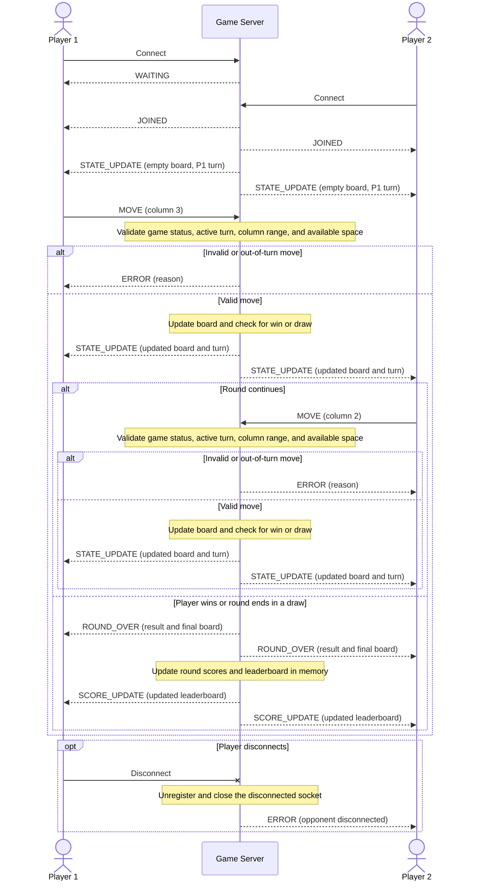

# Concurrency Design

## Server Concurrency Architecture & Connection Lifecycle

The server utilizes Python's `selectors` module to manage multiple client connections within a single-threaded, non-blocking event loop. Both the listening socket and client sockets are set to non-blocking mode using `setblocking(False)`. The selector is responsible for monitoring these sockets to check for readiness for reading and writing.

The server accommodates two players per game. It accepts incoming connections through the listening socket, registers each client socket with the selector, and initializes the connection state for each client. The event loop continuously calls `selector.select()` to identify which sockets are ready, handling incoming messages and outgoing data without blocking the main loop.

Incoming messages are formatted as newline-delimited JSON. If messages are incomplete, they remain in the client's input buffer. Outgoing messages are stored in individual output buffers specific to each client. The selector also monitors for `EVENT_WRITE` as long as there are messages queued, which allows the server to handle partial writes without blocking.

When a client connects, the server assigns them a player slot. The first player to connect receives a "WAITING" status. Once the second player connects, both players receive a "JOINED" status along with the initial "STATE_UPDATE."

During gameplay, the server processes players' move requests, validates them, updates the game state, and queues responses for the appropriate clients. If a client disconnects, the server unregisters and closes their socket, removes them from the list of active clients, and notifies the remaining player if there is an ongoing round.

## Thread Safety, Lock Acquisition & State Isolation Strategy

The server operates using a single-threaded event loop, meaning that all changes to the game state occur sequentially within the loop. As a result, there is no need for `threading.Lock` because no other thread can modify the shared state. This design effectively prevents concurrent state mutations and race conditions. Each move's validation and the subsequent state update are completed within the same event-loop handler before any additional game-state operations are processed.

**Shared Resource State Isolation Strategy:**

- **Board (6 rows × 7 columns):** Modified only by the event loop.
- **Active Player and Game Status:** Modified only by the event loop.
- **Connected Client List:** Modified only by the event loop.
- **Client Input and Output Buffers:** Accessed only by the event loop.
- **State Version and Acknowledgment Set:** Modified only by the event loop.
- **Round Scores:** Modified only by the event loop.

When the server receives a MOVE request, several conditions are validated: the game status, the sender's turn, the column range (0-6), column capacity, and acknowledgment status. If any of these conditions are not met, the server will return an ERROR without making any changes to the board, turn, or scores.

For valid moves, the server places the token in the lowest available cell and checks for four consecutive tokens in horizontal, vertical, or diagonal patterns. It then determines whether the round should continue, end with a win, or end in a draw.

## Mermaid Sequence Diagram

## Move Validation, Turn Enforcement & State Broadcast Flow

When a client sends a `MOVE` request, the server first checks that the round remains active, verifies that the client owns the current turn, ensures the column is within range, and confirms that there is available space in the column. In cases where the move is invalid or made out of turn, the server promptly returns an `ERROR` message to the requesting client without altering the board or changing the active turn.

For a valid move, the server proceeds to update the board, checks for a win or draw condition, and then broadcasts a `STATE_UPDATE` message to both connected clients, including the one who did not make the move. The server handles outgoing messages using non-blocking output buffers to prevent a slow client from hindering the event loop. If the round concludes, a `ROUND_OVER` message is sent to both clients, round scores and the leaderboard are updated in memory, and a `SCORE_UPDATE` notification is broadcast to both clients. After the round has ended, any further moves are rejected by the server.
